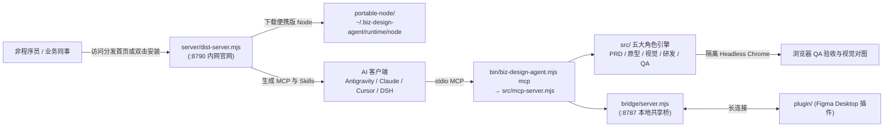

# 仓库目录与文件结构说明

本文档说明 `biz-design-agent` 仓库中各个目录与核心文件的职责、层级关系以及它们之间的协作链路。

---

## 一、仓库层级总览（Mermaid）

```mermaid
flowchart TD
  ROOT["biz-design-agent/（仓库根目录）"]

  ROOT --> ENTRY["入口与配置层"]
  ROOT --> CORE["核心业务引擎"]
  ROOT --> FIGMA["Figma 桥接与画布层"]
  ROOT --> DIST_LAYER["内网分发与多端打包层"]
  ROOT --> DOCS_LAYER["技能、文档与规范层"]
  ROOT --> QA_LAYER["测试与演练样例层"]

  ENTRY --> E1["bin/biz-design-agent.mjs<br/>统一 CLI / MCP / 分发主入口"]
  ENTRY --> E2["fimg<br/>免 npm 便捷 Shell 包装入口"]
  ENTRY --> E3["package.json / AGENTS.md / README.md"]

  CORE --> C1["src/prd.mjs<br/>模式 1：PRD 双端同源与飞书同步"]
  CORE --> C2["src/prototype.mjs<br/>模式 2：可点击线稿原型"]
  CORE --> C3["src/visual-design.mjs<br/>模式 3：高保真视觉源稿"]
  CORE --> C4["src/dev-handoff.mjs<br/>模式 4：研发规格提取与提测单"]
  CORE --> C5["src/qa-verify.mjs & src/visual-diff.mjs<br/>模式 5：隔离浏览器 QA 与像素对图"]
  CORE --> C6["src/mcp-server.mjs / env-doctor.mjs<br/>harness-setup.mjs / zip.mjs"]

  FIGMA --> F1["bridge/server.mjs<br/>本地 HTTP/WS 共享桥 (:8787)"]
  FIGMA --> F2["plugin/<br/>Figma Desktop 本地插件"]
  FIGMA --> F3["tools/figma.mjs<br/>画布读写与导出 CLI"]

  DIST_LAYER --> D1["server/dist-server.mjs<br/>内网分发门户与 /portable-node/ 托管"]
  DIST_LAYER --> D2["portable-node/<br/>官方 Node LTS 便携包目录（大包不入 Git）"]
  DIST_LAYER --> D3["scripts/<br/>build-dist / build-plugins / runtime.sh"]
  DIST_LAYER --> D4["dist/<br/>预渲染引导、多 Harness 插件与一键安装器"]

  DOCS_LAYER --> S1["skills/biz-design-agent/<br/>AI 技能提示词源文件"]
  DOCS_LAYER --> S2["docs/<br/>接入指南、五模式细则与多端插件研究"]
  DOCS_LAYER --> S3["specs/<br/>DSL 校验器与样例规格"]

  QA_LAYER --> T1["test/<br/>契约、全角色、分发、插件与一致性单测"]
  QA_LAYER --> T2["examples/app-delivery/<br/>全角色端到端样例与取证快照"]
```

---

## 二、运行时协作链路（Mermaid）

---

## 三、目录与文件详细说明

### 1. 根目录核心文件

| 路径 | 说明 |
|---|---|
| `package.json` | 项目元数据（版本号、纯 Node `>=18` 声明、零第三方依赖、`npm test` / `build:dist` / `build:plugins` 脚本与 `files` 白名单） |
| `README.md` | 项目总览、三种接入入口、五种工作模式与开发验证速查 |
| `AGENTS.md` | 面向 AI 助手的仓库协作约定与顶层五模式主菜单触发说明 |
| `fimg` | 免 `npm` 的 Shell 便捷入口脚本，通过 `scripts/runtime.sh` 自动寻址 Node 后转发给 `bin/biz-design-agent.mjs` 或 `tools/figma.mjs` |
| `.gitignore` | Git 忽略规则：忽略 `out/`、`node_modules/` 及 `portable-node/` 下的大体积压缩包，显式保留 `dist/` 预打包产物 |

### 2. `bin/` — 统一命令行与服务入口

| 文件 | 说明 |
|---|---|
| `bin/biz-design-agent.mjs` | 唯一统一入口，汇总 `doctor`、`setup`、`install-figma-plugin`、`bridge-ensure`、`mcp`、`prd`、`proto`、`visual`、`dev`、`qa`、`visual-diff`、`serve-dist` 及全部 Figma 画布透传子命令 |

### 3. `src/` — 核心业务与基础设施模块（全纯 Node，零依赖）

| 文件 | 说明 |
|---|---|
| `src/mcp-server.mjs` | 标准 stdio MCP Server 实现，向外暴露 18 项工具（Figma 读写/插件安装、PRD/原型/视觉/研发/QA 菜单与导出、像素对图等） |
| `src/env-doctor.mjs` | 环境自检与基础设施管理：扫描便携版 Node / 系统 Node、Figma Desktop、飞书 CLI（`lark-cli`）、本地桥状态、隔离浏览器探测以及解出 Figma 插件到 `~/Documents/BizDesignAgent-FigmaPlugin` |
| `src/harness-setup.mjs` | 自动识别当前 AI 客户端（Antigravity / Claude Code / Cursor / Trae / Windsurf / 通用），写入绑定绝对路径 `NODE_BIN` 的原生 MCP 配置与规则/Skill |
| `src/prd.mjs` | **模式 1（业务设计 · PRD）**：五选项菜单状态机、读取参考 Word（`.docx`）、同源导出 Figma 单页 PRD 与可编辑 `.docx` / `.md`，以及飞书云文档同步 |
| `src/prototype.mjs` | **模式 2（业务设计 · 原型）**：从 PRD 继承生成可点击线稿原型草稿、断链检查、导出带原生 `reactions` 跳转与屏外 PRD 说明卡的 `Prototype.figma.json` |
| `src/visual-design.mjs` | **模式 3（美工 / UI · 高保真）**：从原型推导高保真视觉草稿、校验团队规范、导出高保真源稿 `Visual.figma.json` 与样式指令 |
| `src/dev-handoff.mjs` | **模式 4（前端 / 研发 · 联调提测）**：从 Figma `dump` 与 PRD 提取色板、字阶、定稿文案与提测规格包 |
| `src/qa-verify.mjs` | **模式 5（测试 / 走查 · 功能验收）**：定位并探测隔离 Headless Chrome/Chromium/Edge，执行页面步骤验收与截屏取证，严格区分通过/失败/未测 |
| `src/visual-diff.mjs` | **模式 5（视觉还原对图）**：纯 Node PNG 编解码与像素级差异比对（支持遮罩区与差异包围盒输出，零 Pillow 依赖） |
| `src/zip.mjs` | 纯 Node 零依赖 ZIP 打包工具（供 Word `.docx` 生成与分发中心打包一键安装包 / 插件 ZIP 使用） |

### 4. `bridge/`、`plugin/`、`tools/` — Figma 本地画布链路

| 路径 | 说明 |
|---|---|
| `bridge/server.mjs` | 常驻本地 HTTP/长轮询共享桥（默认端口 `:8787`），负责在本地 CLI/MCP 与 Figma Desktop 插件之间转发读写指令 |
| `plugin/manifest.json` | Figma Desktop 开发版插件清单（插件名 `Biz Design Agent`，白名单指向本地桥端口） |
| `plugin/code.js` | Figma 插件沙箱主逻辑，执行画布节点读取、渲染、补丁修改、样式/组件操作与导出 |
| `plugin/ui.html` | Figma 插件侧边面板 UI，负责与本地桥建立通信并展示连接状态 |
| `tools/figma.mjs` | 面向画布的底层命令行工具（`status` / `ping` / `list` / `sel` / `dump` / `render` / `patch` / `insert` / `rm` / `export` / `clear` 等） |

### 5. `server/`、`portable-node/`、`scripts/`、`dist/` — 分发门户与构建产物

| 路径 | 说明 |
|---|---|
| `server/dist-server.mjs` | 零依赖内网分发服务：托管安装首页 `/`、动态 `/bootstrap.md`、离线包 `/packages/*.tgz`、一键安装包 `/downloads/*.zip` 及 `/portable-node/` 便携版 Node 下载与平台别名自动路由 |
| `portable-node/` | 存放官方 Node.js LTS 便携压缩包（`darwin-arm64` / `darwin-x64` / `win-x64`），大体积压缩包由 `.gitignore` 忽略、上线时手动传至服务器；Git 仅追踪 `README.txt` 与 `SHASUMS256.txt` |
| `scripts/build-dist.mjs` | 预渲染构建脚本：从 `server/dist-server.mjs` 生成静态 `dist/bootstrap.md`、`dist/index.html`、`dist/meta.json` 并调用 `build-plugins.mjs` |
| `scripts/build-plugins.mjs` | 多 Harness 插件构建器：生成 `dist/harness-plugin/`（四端通用插件）、`dist/dsh-bundle/`（DeepSeek Harness 专用包）与 `dist/installers/`（Mac/Win 双击安装器） |
| `scripts/runtime.sh` | Shell 公共运行时解析脚本（被 `fimg` 和 `start-bridge.sh` 引用），优先探测便携版 Node 与系统 Node `>= 18` |
| `scripts/start-bridge.sh` | 前台启动本地 Figma 桥的便捷脚本，含端口占用检测 |
| `scripts/run-live-role-simulation.mjs` | 四角色真机全链路演练脚本（依赖真实 Figma Desktop 与浏览器） |
| `dist/` | **自动生成并随仓库提交的分发产物**（勿手工修改，改源码后运行 `npm run build:dist` 刷新），包含静态引导、通用插件、DSH 插件与双击安装器 |

### 6. `skills/`、`specs/`、`docs/` — 技能源、规范与文档

| 路径 | 说明 |
|---|---|
| `skills/biz-design-agent/SKILL.md` | 随插件和工作区下发的统一 AI 技能主入口（五模式主菜单与工作流路由规范） |
| `specs/validate-spec.mjs` | Figma 规格 DSL 静态校验脚本（`npm run check`） |
| `specs/stock-app.json` | 引擎测试与校验用的示例规格 JSON（非业务默认规范） |
| `docs/SETUP.md` | 面向 AI 助手的完整接入说明书与逐项验收清单 |
| `docs/DESIGN-AGENT.md` | 多团队、多产物整体架构决策与试点规划 |
| `docs/PRD-WORKFLOW.md` 等 5 份 `*-WORKFLOW.md` | 五大业务角色模式的工作流细则与菜单约定 |
| `docs/CAPABILITIES.md` / `ITERATING.md` / `SPEC_DSL.md` / `TEAM-INTAKE.md` | 能力手册、现有稿迭代指南、DSL 参考与团队规范卡模板 |
| `docs/ROLE-SIMULATION-REPORT.md` | 真实 Figma + 隔离浏览器四角色真机演练报告 |
| `docs/harness-plugins/` | Antigravity / Claude Code / Codex / DSH 插件架构研究、验证交接单及 `raw/` 原始官方文档归档 |

### 7. `test/`、`examples/`、`out/` — 测试、样例与临时输出

| 路径 | 说明 |
|---|---|
| `test/*.test.mjs` | 主测试套件（由 `npm test` 统一执行）：覆盖契约（`design-contract`）、PRD/原型（`prd-workflow`）、全角色（`all-roles`）、浏览器降级（`browser-fallback`）、内网分发与便携版 Node（`distribution`）、多 Harness 插件自包含性（`harness-plugins`）及全仓一致性（`consistency`） |
| `test/plugin.test.mjs` | Figma 插件专项测试（`npm run test:plugin`，需真实 Figma 环境） |
| `test/fake-plugin.mjs` & `test/figma-stub.mjs` | 无 Figma 环境下的插件模拟器与画布桩，供单测离线验证渲染与导出 |
| `examples/app-delivery/` | 全角色演练样例数据（PRD / 原型 / 视觉源 JSON、培训手册及多轮取证截图） |
| `out/` | 本地运行导出临时目录（已被 `.gitignore` 忽略） |

---

## 四、维护速查：改了什么、需要同步跑什么

| 修改内容 | 需要执行的命令 |
|---|---|
| 修改 `server/dist-server.mjs`、`src/`、`bin/`、`skills/` 或 `scripts/build-plugins.mjs` | 运行 `npm run build:dist` 同步刷新 `dist/`，再运行 `npm test` |
| 修改 `plugin/` 下的 Figma 插件代码 | 运行 `npm run build:dist` 同步到插件包，再运行 `npm run test:plugin` 并在 Figma 测试副本复测 |
| 升级便携版 Node.js LTS | 替换本地 `portable-node/` 下的压缩包并手动上传到服务器对应目录（无需改代码） |
